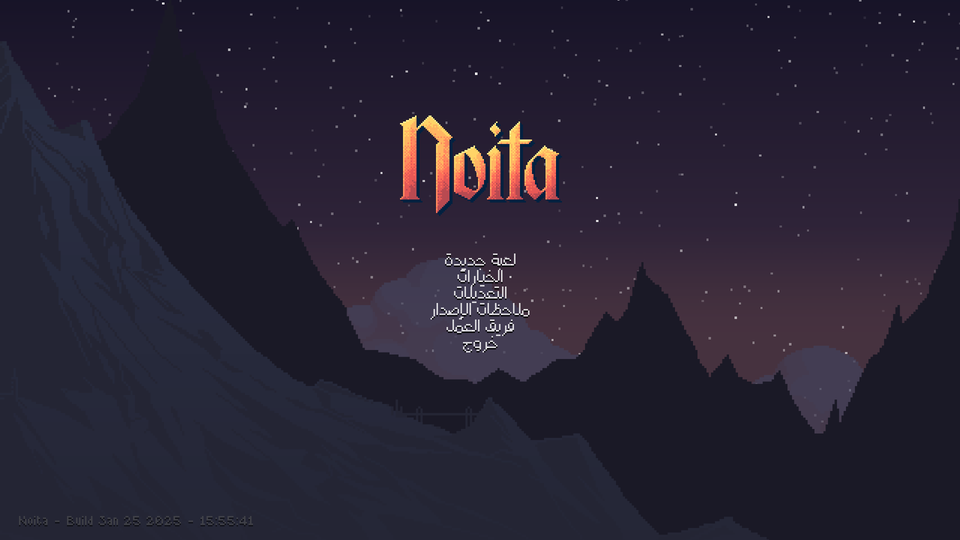
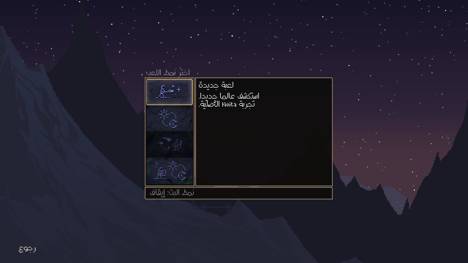
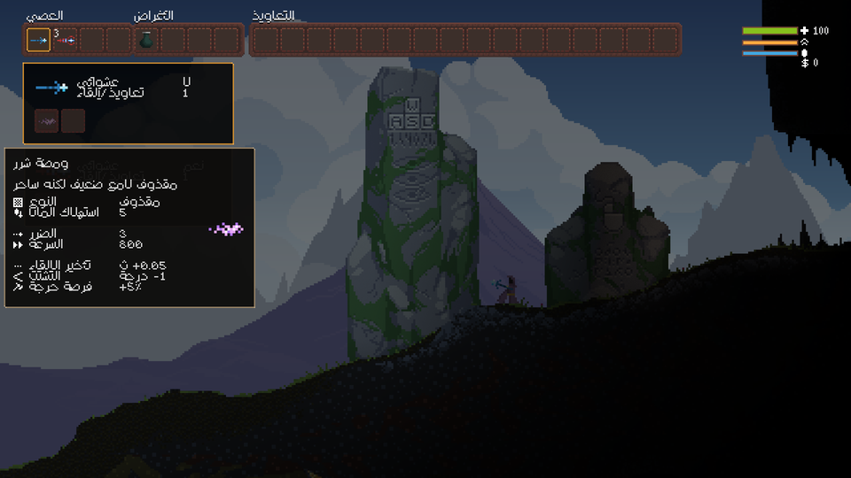

<div dir="rtl">

# تعريب Noita

تعريب كامل للعبة **Noita**: القوائم والخيارات والعصي والتعاويذ والمواهب والمواد والمخلوقات
والمناطق ورسائل اللعب والألواح الزمردية. يستخدم نظام الترجمة الرسمي الذي تدعمه اللعبة،
فلا يعدل ملفات اللعبة ولا يؤثر في الإنجازات. الخط خط بكسلي عربي بحجم خط اللعبة الأصلي نفسه،
فتبقى القوائم بمقاساتها الأصلية.

</div>






<div dir="rtl">

## التنزيل

نزّل أحدث ملف من صفحة **[الإصدارات](../../releases)**، ثم فُكّ ضغطه.

## التثبيت على ويندوز

انقر نقرًا مزدوجًا على `install-windows.bat`.

تفتح نافذة صغيرة تعثر على اللعبة وحدها؛ اضغط **تثبيت**. وإن لم تجدها، اضغط **استعراض**
وحدّد المجلد الذي يحتوي على `noita.exe`.

إن ظهرت رسالة عن الصلاحيات، اضغط على الملف بزر الفأرة الأيمن واختر **تشغيل كمسؤول**.

## التثبيت على لينكس

</div>

```bash
./install.sh
```

<div dir="rtl">

ولتحديد مسار اللعبة بنفسك:

</div>

```bash
./install.sh /path/to/Noita
```

<div dir="rtl">

## تشغيل التعريب

1. شغّل اللعبة، ومن القائمة الرئيسية افتح **Mods** وفعّل **Arabic Translation**.
2. أعد تشغيل اللعبة.
3. افتح **Options** ثم **Language** واختر **العربية**.
4. اخرج من اللعبة عبر قائمة الخروج مرة واحدة على الأقل: اللعبة تحفظ اختيار اللغة عند الخروج
   السليم فقط، ولو أغلقتها بالقوة فستعود إلى الإنجليزية في المرة القادمة.

## الإزالة

اختر English من **الخيارات ← اللغة** أولًا، ثم في ويندوز شغّل `install-windows.bat` واضغط
**إزالة**. وفي لينكس:

</div>

```bash
./install.sh --uninstall
```

<div dir="rtl">

## ما ينبغي معرفته

- بعض الجمل تركّبها اللعبة من أجزاء منفصلة (مثل «جرعة ماء» ثم «(ممتلئة 100%)»)، وترتبها
  دائما من اليسار إلى اليمين. كل جزء يُقرأ صحيحا، لكن ترتيب الأجزاء قد يأتي معكوسا.
- الخط لا يعرض التشكيل، فكُتب النص بلا حركات.
- أسماء المخلوقات الفنلندية منقولة بحروف عربية كما تفعل الترجمات الرسمية الأخرى
  (الهيسي، ستنداري، كولميسيلما...).
- تلميحات العصي والتعاويذ ترصّ أسطرها كل 8 بكسلات، وهي مسافة ثابتة داخل محرّك اللعبة،
  فتتقارب الأسطر العربية أكثر من الإنجليزية. في المجلد `spacing_mod` إضافة **تجريبية** توسّع
  هذه المسافة، لكنها تتطلب تفعيل «التعديلات غير الآمنة» ولم تُختبر داخل اللعبة بعد، لذا لا
  يثبّتها المثبّت.
- بقيت نحو 30 عبارة تقنية (صيغ الأرقام والتوقيت ونصوص التصحيح) كما هي.

## وجدت خطأً؟

افتح بلاغا وأرفق لقطة شاشة، واذكر مكان ظهور النص في اللعبة. إن استطعت فاذكر المفتاح من
`src/ar/*.json`.

## الخطوط والتراخيص

- الحروف العربية من خط [Pixel AE](https://essssam.itch.io/pixel-ae) لعصام، ورخصته CC0.
- الحروف اللاتينية في أطلس الخط منسوخة من خطوط Noita نفسها، وهي ملك Nolla Games.
- التعريب عمل غير رسمي، ولا علاقة له بـ Nolla Games.

## للمساهمين

التفاصيل التقنية في [docs/internals.md](docs/internals.md)، والمصطلحات في
[docs/glossary.md](docs/glossary.md).

</div>
