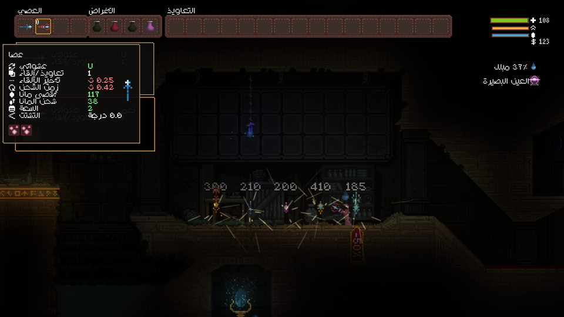

<div dir="rtl">

# ‏Noita‎ بالعربية

تعريب كامل للعبة [‏Noita‎](https://store.steampowered.com/app/881100/): القوائم والخيارات
والعصي والتعاويذ والمواهب والمواد والمخلوقات والمناطق ورسائل اللعب والألواح الزمردية —
**3,686 نصًّا من 3,706**؛ والعشرون الباقية أسطر فارغة في بيانات اللعبة لا نص فيها.

يُثبَّت بالطريقة التي تدعمها اللعبة لتعديلات الترجمة، فلا يُعدَّل أي ملف من ملفات اللعبة،
ولا تُفعَّل قيود التعديلات (فالإنجازات تبقى كما هي). الخط بكسلي عربي بحجم خط اللعبة الأصلي،
فتبقى القوائم بمقاساتها.

</div>

[](../../releases/latest)
[](LICENSE)
[](#)




<div dir="rtl">

## في سطور

| | |
|---|---|
| **ما يعرّبه** | القوائم والخيارات والعصي والتعاويذ والمواهب والمواد والمخلوقات والمناطق والرسائل |
| **ملفات اللعبة** | لا يُمَس منها شيء؛ كل شيء داخل `mods/translation_ar` |
| **الإزالة** | حذف المجلد من المثبّت (أو يدويًا) |
| **الإنجازات** | تبقى كما هي، لأنه تعديل ترجمة لا يفعّل قيود التعديلات |
| **متطلبات إضافية** | لا شيء |

## المتطلبات

| النظام | ما يلزم |
|---|---|
| ويندوز 10 أو 11 | لا شيء غير النظام نفسه (PowerShell مثبَّت مسبقًا) |
| لينكس | `bash`، وأي توزيعة حديثة |
| ستيم ديك | وضع سطح المكتب (Desktop Mode) |
| اللعبة | نسخة Steam أو GOG من ‏Noita‎ (اللعبة نفسها تعمل عبر Proton على لينكس) |

## التنزيل

من صفحة **[الإصدارات](../../releases/latest)** نزّل `NoitaArabic-1.0.0.zip` (نحو 150 ك.ب)،
ثم **فُكّ ضغطه** قبل أي خطوة أخرى.

## التثبيت على ويندوز

1. **أغلق اللعبة** إن كانت مفتوحة.
2. فُكّ ضغط الملف: زر الفأرة الأيمن ← **Extract All…** ← **Extract**.
3. افتح المجلد الناتج، وانقر نقرًا مزدوجًا على `install-windows.bat`.
4. تفتح نافذة صغيرة تعثر على اللعبة وحدها. اضغط **تثبيت**.
5. إن لم يجدها، اضغط **استعراض…** وحدّد المجلد الذي يحتوي على `noita.exe`.

إن ظهرت رسالة عن الصلاحيات، انقر على `install-windows.bat` بزر الفأرة الأيمن واختر
**تشغيل كمسؤول**.

## التثبيت على لينكس

فُكّ الضغط، ثم من داخل المجلد:

</div>

```bash
./install.sh
```

<div dir="rtl">

ولتحديد مسار اللعبة بنفسك:

</div>

```bash
./install.sh "/path/to/Noita"
```

<div dir="rtl">

وإن ظهرت رسالة `Permission denied`، فمعنى ذلك أن مدير الملفات لم يحفظ صلاحية التنفيذ:

</div>

```bash
chmod +x install.sh && ./install.sh
```

<div dir="rtl">

## التثبيت على ستيم ديك

1. اضغط **STEAM** ← **Power** ← **Switch to Desktop**.
2. افتح **Konsole** من قائمة التطبيقات.
3. اكتب:

</div>

```bash
cd ~/Downloads/NoitaArabic-1.0.0
./install.sh
```

<div dir="rtl">

4. سيجد المثبّت اللعبة في مكتبة Steam على الجهاز أو بطاقة الذاكرة. ثم عُد إلى وضع اللعب.

## تشغيل التعريب

1. شغّل اللعبة، ومن القائمة الرئيسية افتح **Mods** وفعّل **Arabic Translation**.
2. أعد تشغيل اللعبة.
3. افتح **Options** ثم **Language** واختر **العربية**.
4. اخرج من اللعبة عبر قائمة الخروج مرة واحدة على الأقل: اللعبة لا تحفظ اختيار اللغة إلا عند
   الخروج السليم، وإن أغلقتها بالقوة عادت إلى الإنجليزية في المرة التالية.

## الإزالة

اختر **English** من **الخيارات ← اللغة** أولًا، ثم:

- ويندوز: شغّل `install-windows.bat` واضغط **إزالة**.
- لينكس: `./install.sh --uninstall`

حذف مجلد `mods/translation_ar` بيدك يكفي أيضًا، فالمثبّت لا يضع شيئًا خارجه.

## بعد تحديث اللعبة

الترجمة تُدمج بمفاتيح نصوص اللعبة، فالتحديث لا يعطّلها عادةً: المفاتيح الجديدة تظهر
بالإنجليزية حتى تُترجَم، والباقي يبقى عربيًا. وبعد كل تحديث كبير:

1. تحقّق من وجود إصدار أحدث من التعريب.
2. ثبّته فوق القديم؛ المثبّت يستبدل مجلد الترجمة كاملًا.
3. إن ظهرت مربّعات أو نص مبتور، فأعد التثبيت أولًا، ثم أبلغ عن النص.

## إن لم يعمل

| ما تراه | السبب | الحل |
|---|---|---|
| لا يظهر **Arabic Translation** في قائمة Mods | المجلد نُسخ إلى مكان خطأ | أعد التثبيت وحدّد المجلد الذي فيه `noita.exe` |
| التعديل مفعّل والنص ما زال إنجليزيًا | لم تُختر اللغة | **Options** ← **Language** ← **العربية** |
| اللغة تعود للإنجليزية كل مرة | أُغلقت اللعبة بالقوة | اخرج من قائمة الخروج مرة واحدة |
| الحروف تظهر مربّعات | خط الترجمة لم يُحمّل | أعد التثبيت، وتأكد أن المجلد كامل |
| أسطر التلميحات متلاصقة | مسافة الأسطر ثابتة في المحرّك | جرّب `spacing_mod` (تجريبي، انظر أدناه) |
| ويندوز يمنع تشغيل `.bat` | سياسة PowerShell | انقر بزر الفأرة الأيمن ← **تشغيل كمسؤول** |

## أسئلة سريعة

**هل تُعطّل الإنجازات؟** لا. اللعبة تفرض قيودها على التعديلات العادية، أما تعديلات الترجمة
(`is_translation`) فمستثناة.

**هل يعمل مع تعديلات أخرى؟** نعم، لكن كل تعديل غير ترجمة يُفعّل قيود اللعبة، وهذا شأنه هو.

**هل يلزم حفظ جديد؟** لا. الترجمة تعمل على أي حفظ قائم.

**هل يوجد لعب جماعي في Noita؟** لا.

## ما ينبغي معرفته

- **ملفات اللعبة لا تُمَس.** كل شيء داخل `mods/translation_ar`، والإزالة تحذفه.
- بعض الجمل تركّبها اللعبة من أجزاء منفصلة (مثل «جرعة ماء» ثم «(ممتلئة 100%)»)، وترتّبها
  دائمًا من اليسار إلى اليمين؛ كل جزء يُقرأ صحيحًا، لكن ترتيب الأجزاء قد يأتي معكوسًا.
- الخط لا يعرض التشكيل، فكُتب النص بلا حركات.
- أسماء المخلوقات الفنلندية منقولة بحروف عربية كما تفعل الترجمات الرسمية الأخرى
  (الهيسي، ستنداري، كولميسيلما…).
- تلميحات العصي والتعاويذ ترصّ أسطرها كل 8 بكسلات، وهي مسافة ثابتة داخل المحرّك، فتتقارب
  الأسطر العربية أكثر من الإنجليزية. في `spacing_mod` إضافة **تجريبية** توسّع المسافة، لكنها
  تتطلب تفعيل «التعديلات غير الآمنة» ولم تُختبر داخل اللعبة بعد، لذا لا يثبّتها المثبّت.
- بقيت صيغ الأرقام والتوقيت ونصوص التصحيح كما هي عمدًا.

## للمهتمين تقنيًا

| ما يفعله المثبّت | التفصيل |
|---|---|
| ينسخ | `translation_ar/` إلى `mods/` داخل مجلد اللعبة |
| لا يعدّل | أي ملف من ملفات اللعبة أو حفظاتها |
| يتحقق من اللعبة | عبر `appmanifest_881100.acf` و`libraryfolders.vdf` لكل مكتبات Steam |
| الإزالة | حذف المجلد نفسه، لا أكثر |

شرح آلية العمل وبنية المشروع في [docs/internals.md](docs/internals.md)، ودليل المصطلحات في
[docs/glossary.md](docs/glossary.md).

## الخطوط والتراخيص

- الحروف العربية من خط [Pixel AE](https://essssam.itch.io/pixel-ae) لعصام، ورخصته CC0.
- الحروف اللاتينية في أطلس الخط منسوخة من خطوط Noita نفسها، وهي ملك Nolla Games.
- شيفرة المشروع برخصة MIT. التعريب عمل غير رسمي، ولا علاقة له بـ Nolla Games.

## الإبلاغ والمساهمة

افتح [مشكلة](../../issues) وأرفق لقطة شاشة، واذكر مكان ظهور النص في اللعبة. إن استطعت فاذكر
المفتاح من `src/ar/*.json`.

</div>
